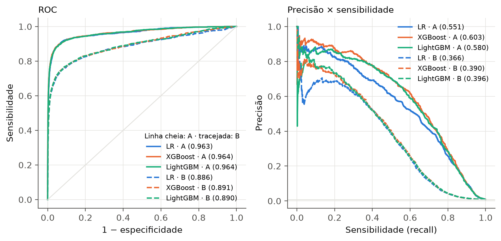
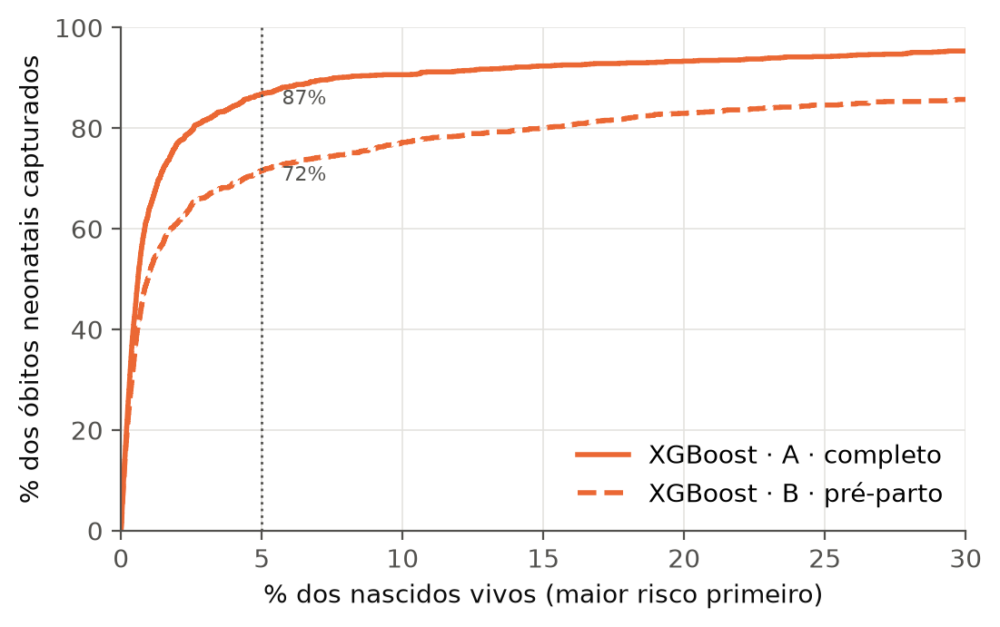
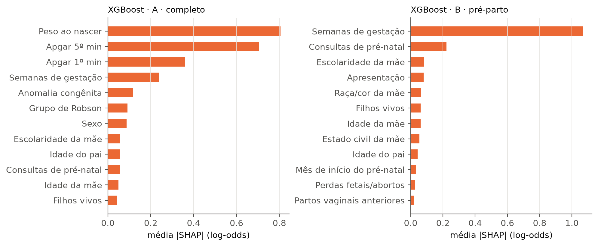
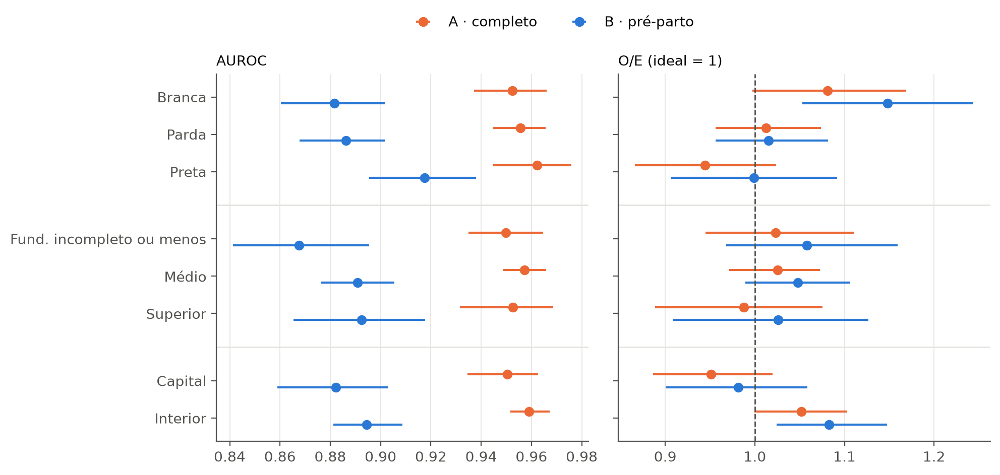
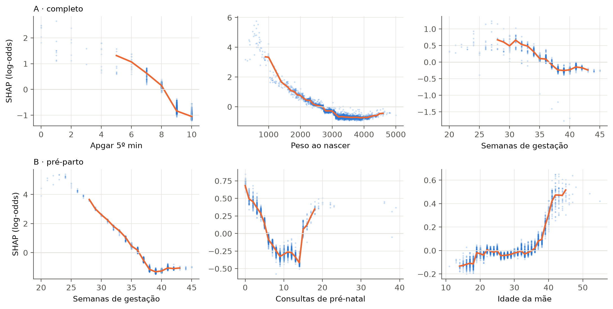
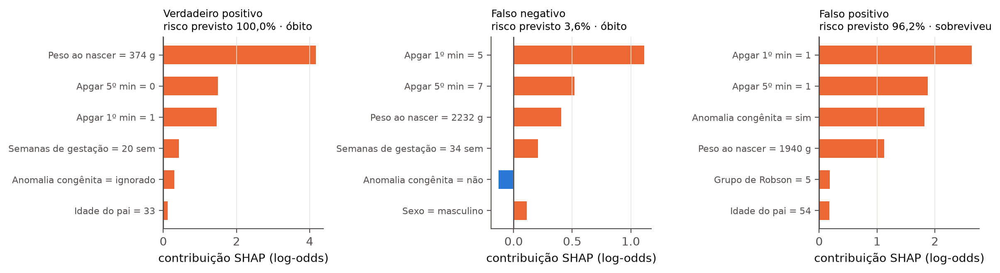
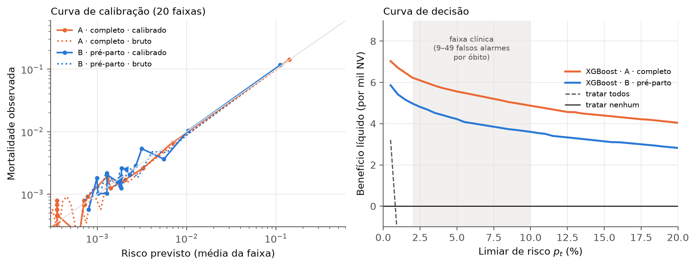

# Predição de mortalidade neonatal no RJ com dados abertos (SINASC × SIM, 2017–2023)

Projeto de Aplicação — **Introdução ao Aprendizado de Máquina para a Saúde** (UFF, 2026.2, Prof. Flávio Luiz Seixas).
Aluno: Cledson da Silva Araújo.

- **Proposta:** [`proposta/proposta.pdf`](proposta/proposta.pdf).
- **Documentação (Parte 1):** este arquivo.
- **Demonstração (Parte 2):** [`notebook/mortalidade_neonatal_rj.ipynb`](notebook/mortalidade_neonatal_rj.ipynb).
- **Relatório (formato SBC, 12 páginas):** [`relatorio/main.pdf`](relatorio/main.pdf).
- **Slides (16, com notas do apresentador, ~14 min de fala):** [`slides/apresentacao.pptx`](slides/apresentacao.pptx).
- **Apresentação do tema (modelo .odp da disciplina):** [`slides/apresentacao_tema.odp`](slides/apresentacao_tema.odp).
- **Repositório:** <https://github.com/CledsonSilvaAraujo/mortalidade-neonatal-rj>.

---

## 1. Motivação e objetivo

A mortalidade neonatal (óbito de 0 a 27 dias de vida) é a maior parte da mortalidade infantil no Brasil. No estado do RJ, a taxa foi de **8,62 óbitos por mil nascidos vivos** entre 2017 e 2023. A Declaração de Nascido Vivo (DN) é preenchida para todo nascimento, então um escore de risco calculado a partir dela pode apoiar a priorização de UTI neonatal, o transporte e a visita domiciliar.

O **artigo de referência** é Batista AFM, Diniz CSG, Bonilha EA, Kawachi I, Chiavegatto Filho ADP. *Neonatal mortality prediction with routinely collected data: a machine learning approach.* BMC Pediatrics 21:322, 2021 ([doi:10.1186/s12887-021-02788-9](https://doi.org/10.1186/s12887-021-02788-9)).
- Dados do município de São Paulo, com nascimentos de 2012–2017 pareados aos óbitos com dados identificados.
- Validação temporal: treino em 2012–2016 e teste em 2017.
- O XGBoost teve **AUROC 0,971**, AUPRC 0,586 e F1 0,548, com mais de 90% dos óbitos entre os 5% de maior risco.

Lacunas do artigo:
- ele depende de dados identificados;
- usa uma única cidade;
- depende de variáveis do pós-parto;
- não avalia calibração nem subgrupos, lacunas também apontadas pela revisão de Mangold et al. (2021).

**Perguntas de pesquisa**
1. O desempenho se reproduz no estado do RJ **só com microdados públicos**, que não têm identificadores? (H1: AUROC ≥ 0,95)
2. Quanto se perde com um modelo **pré-parto**, que usa apenas o que se sabe na admissão? (H2: queda substancial, com o modelo ainda útil)
3. O modelo é **calibrado e equitativo** por raça/cor e escolaridade da mãe e entre capital e interior? (H3: **a calibração** piora nos subgrupos de menor escolaridade)

## 2. Dataset

### 2.1 Descrição

| | SINASC (nascidos vivos) | SIM (óbitos) |
|---|---|---|
| Responsável | Ministério da Saúde / DATASUS | Ministério da Saúde / DATASUS |
| Arquivos | `DNRJ2017.dbc` … `DNRJ2023.dbc` (7) | `DORJ2017.dbc` … `DORJ2024.dbc` (8) |
| Recorte | residentes no estado do RJ | residentes no estado do RJ |
| Registros | 1.397.216 nascidos vivos | 12.039 óbitos neonatais de nascidos em 2017–2023 |
| Link | <ftp://ftp.datasus.gov.br/dissemin/publicos/SINASC/1996_/Dados/DNRES/> | <ftp://ftp.datasus.gov.br/dissemin/publicos/SIM/CID10/DORES/> |

- **Download automático:** `src/download.py` baixa tudo e guarda cache em `data/raw/`, sem cadastro nem passo manual.
- **Por que o SIM vai até 2024:** para captar os óbitos de quem nasceu no fim de 2023.
- **Desfecho:** óbito não fetal (`TIPOBITO = 2`) com 0 a 27 dias completos de vida, calculados como `DTOBITO − DTNASC`.

### 2.2 Linkage SINASC × SIM sem identificadores (`src/linkage.py`)

Os arquivos públicos **não trazem o número da DN** (`NUMERODN`), o nome da mãe nem o endereço. A Declaração de Óbito de menores de 1 ano, porém, repete dados do nascimento. Por isso, cada óbito é pareado a um nascido vivo por **concordância exata em chaves compostas, aplicadas em cascata**. Em cada passada, só são aceitos pares **1:1**: a chave tem de ser única entre os nascidos ainda não pareados e entre os óbitos ainda não pareados.

| Passada | Chave | Pares | Falsos pares estimados* |
|---|---|---|---|
| 1 | data + sexo + município + peso + idade da mãe + semanas + gravidez + parto | 5.338 | 0% (referência) |
| 2 | data + sexo + município + peso + idade da mãe | 3.521 | 6–8% |
| 3 | data + sexo + município + peso + estabelecimento | 771 | 17–32% |
| 4 | data + sexo + peso + idade da mãe | 439 | 11% |
| 5 | data + sexo + município + idade da mãe + semanas | 492 | 13–16% |
| 6 | data + sexo + município + estabelecimento + idade da mãe | 288 | 22% |

\*Estimativa por **mistura** em campos que nunca entram nas chaves (escolaridade da mãe e perdas fetais anteriores): f = (c_verd − c_k)/(c_verd − c_acaso).
- c_verd é a concordância na passada 1.
- c_acaso é a concordância entre pares sorteados com a mesma data e o mesmo sexo.

Duas chaves mais tolerantes foram testadas e **descartadas** por excesso de falsos pares: data + sexo + município + peso, e data + sexo + município + estabelecimento. A última pareia neonatos transferidos com outro recém-nascido do hospital onde morreram.

**Resultado do linkage**
- **10.849 de 12.039 óbitos pareados (90,1%)**, entre 88,5% e 91,6% conforme o ano.
- Descontados os falsos pares estimados (média ponderada de 6%), cerca de **85% dos óbitos têm um par verdadeiro**.
- **Premissa da estimativa:** a passada 1 (chave completa, 8 campos) não tem falsos pares. Se tiver, as demais estimativas estão subestimadas.
- Pareamento por região: **94,3% na capital** e **88,0% no interior**. Por raça/cor do **recém-nascido** (a única que a DO informa), vai de 89,1% a 90,5%. A raça/cor da **mãe**, usada nos subgrupos, não está na DO.
- **Completude por ano e região:** é estável entre os anos. Em 2023, ficou ≈2 pontos acima do treino **nas duas regiões**:

  | Região | Pareamento 2017–2022 | Pareamento 2023 | O/E esperado só pelo linkage | O/E A / B (bruto) |
  |---|---|---|---|---|
  | Capital | 94,0% | 95,8% | 1,02 | 0,93 / 0,96 |
  | Interior | 87,8% | 89,6% | 1,02 | 1,02 / 1,05 |

  O linkage desloca o O/E igualmente nas duas regiões, então **não explica** a diferença entre capital e interior.
- A comparação com Maia et al. (2017) exige cautela: eles tiveram 90,8% nas capitais (93,1% nas capitais do Sudeste), mas com óbitos **infantis** e dados **identificados**.
- A taxa de mortalidade neonatal na base pareada é de 7,76‰, contra 8,62‰ no SIM.

**Quem fica sem par** (`src/complementares.py`, comparação pelas informações da própria DO):

| Na Declaração de Óbito | Pareados | Não pareados |
|---|---|---|
| n | 10.849 | 1.190 |
| Peso ausente | 0,8% | 26,7% |
| Semanas de gestação ausentes | 4,9% | 31,6% |
| Idade da mãe ausente | 2,1% | 32,5% |
| Peso mediano | 1.100 g | 1.408 g |
| Residente na capital | 35,2% | 19,6% |
| Óbito em hospital | 98,2% | 90,0% |

- Os não pareados são óbitos com campos das chaves ausentes na DO: só 21% dos óbitos sem peso foram pareados.
- O perfil deles é **diferente**, e não necessariamente menos grave: mais campos ausentes, mais do interior e mais óbitos no 1º dia e fora do hospital (óbito precoce fora do hospital ou em trânsito).
- O peso mediano maior dos não pareados é uma comparação com seleção: ele só é calculado entre quem tem peso preenchido, e 27% deles não têm.
- Isso **não** tornou a ausência na DN um sinal de sobrevivência: na base pareada, a TMN é **maior** quando o campo falta (seção 3.5).

### 2.4 Versão dos dados e aspectos éticos

- **Versão:** [`manifesto_dados.csv`](manifesto_dados.csv) registra, para cada arquivo, URL, tamanho, **SHA-256** e data do download (24/09/2026). Gerado por `download.manifesto()`.
- **Situação dos dados:** todos são **definitivos**. Os preliminares do SIM (`SIM/PRELIM/DORES`) só começam em 2025.
- **Ética:** os dados são públicos e sem identificação nominal, o que dispensa CEP/Conep (Res. CNS 510/2016, art. 1º, parágrafo único).
- **Risco de reidentificação:** o próprio linkage cria esse risco, porque data, sexo, peso e município tornam o registro quase único. Por isso, o repositório publica o código, mas **não a base pareada** (`data/` está no `.gitignore`).

### 2.3 Preparação dos dados (`src/preprocess.py`)

- **Numéricas (13):**
  - idade da mãe e do pai;
  - filhos vivos, perdas fetais, gestações, partos vaginais e cesáreas anteriores;
  - semanas de gestação;
  - consultas e mês de início do pré-natal;
  - Apgar 1 e 5;
  - peso.

  O código de "ignorado" (99, ou 9999 no peso) vira ausente.
- **Categóricas (14):**
  - local de nascimento;
  - estado civil, escolaridade (2010) e raça/cor da mãe;
  - tipo de gravidez e de parto;
  - sexo;
  - anomalia congênita;
  - apresentação;
  - indução;
  - cesárea antes do trabalho de parto;
  - quem assistiu o parto;
  - grupo de Robson;
  - índice de Kotelchuck.

  O "9" (ignorado) e o campo vazio viram **categorias próprias**, porque o não preenchimento também é informativo.
- **Derivada:** residência na capital.
- **Exclusão do artigo:** idade gestacional fora de 15–45 semanas. Nenhum registro foi excluído, porque o SINASC já valida o campo.
- **Imputação e encoding:**
  - no XGBoost e no LightGBM, ausentes e categorias são tratados de forma nativa;
  - na regressão logística, há imputação pela mediana com indicador de ausência, padronização e one-hot, **ajustados só no treino** (dentro do `Pipeline`).

| Fluxo | n |
|---|---|
| Nascidos vivos residentes no RJ, 2017–2023 | 1.397.216 |
| Com data de nascimento válida | 1.397.216 |
| Idade gestacional entre 15 e 45 semanas (ou ausente) | 1.397.216 |
| Óbitos neonatais pareados (positivos) | 10.849 (0,78%) |

## 3. Modelo de aprendizado de máquina

### 3.1 Conjuntos de variáveis

- **(A) Completo, 28 variáveis:** as da DN, como no artigo.
- **(B) Pré-parto, 17 variáveis:** o que se sabe **na admissão para o parto**. A idade gestacional é a do parto, e consultas e Kotelchuck dependem dela. Por isso, o modelo estima o risco *dado que o parto ocorre agora*; ele **não** serve para triagem semanas antes.
  - Entram: mãe, pai, histórico obstétrico, idade gestacional, gravidez, apresentação, pré-natal, Kotelchuck e capital.
  - Saem: Apgar, peso, anomalia, sexo, local e tipo de parto, indução, cesárea antes do trabalho de parto, quem assistiu e grupo de Robson.

### 3.2 Formalização

- **Regressão logística** (linha de base):
  - P(y = 1 | **x**) = σ(β₀ + **β**ᵀ**x**), com σ(z) = 1/(1 + e⁻ᶻ);
  - penalização L2, com C ∈ {0,01; 0,1; 1} escolhido na validação;
  - `class_weight="balanced"`.
- **XGBoost** (modelo do artigo) e **LightGBM**:
  - F(**x**) = Σₖ fₖ(**x**), com K árvores de regressão ajustadas em sequência (gradient boosting);
  - P(y = 1 | **x**) = σ(F(**x**));
  - cada árvore minimiza a expansão de 2ª ordem da log-loss + Ω(f) = γT + ½λ‖w‖² + α‖w‖₁.
- **Desbalanceamento** (prevalência de ~0,8%):
  - `scale_pos_weight` é tratado como **hiperparâmetro**, com as opções nenhum, √(n₀/n₁) ou n₀/n₁;
  - a busca escolheu **nenhum** nos dois conjuntos;
  - não se usa sobreamostragem, para preservar a calibração.
- **Recalibração:**
  - uma regressão isotônica ajustada em 2022 corrige as probabilidades;
  - como ela é uma função em degraus e cria empates, as métricas de **ordenação** (AUROC, AUPRC e top 5%) usam o escore bruto;
  - as métricas de **valor** (Brier, O/E e as métricas no limiar) usam a probabilidade recalibrada.
- **Complexidade:**
  - XGBoost com histogramas: O(K·n·d) por ajuste e O(K·profundidade) por predição;
  - regressão logística: O(n·d') por iteração do L-BFGS.

### 3.3 Método de validação

A **validação é temporal**, espelhando o artigo (treino no passado, teste no ano seguinte):

| Amostra | Anos | Nascidos vivos | Óbitos | TMN (‰) | Uso |
|---|---|---|---|---|---|
| Ajuste | 2017–2021 | 1.040.702 | 8.017 | 7,70 | treino |
| Validação | 2022 | 180.369 | 1.388 | 7,70 | Optuna, early stopping, isotônica, limiar |
| Teste | 2023 | 176.145 | 1.444 | 8,20 | avaliação final, **usada uma única vez** |

**Hiperparâmetros:**
- **Busca:** otimização bayesiana (Optuna/TPE, semente 42) maximizando a **AUPRC** na validação.
- **Tentativas:** 15 para o XGBoost e 10 para o LightGBM, com early stopping de 50 árvores.

**Por que essas escolhas:**
- **Busca curta:** cada ajuste leva ~20 s com 10⁶ registros, e a melhor AUPRC estabilizou antes da metade das tentativas (figura `optuna.png`).
- **Holdout temporal em vez de validação cruzada:** imita o uso real, de treinar no passado e aplicar no ano seguinte.
- **Validação reutilizada:** 2022 serve para early stopping, Optuna, isotônica e limiar, então as métricas **de validação** são otimistas. O teste de 2023 continua intocado.
- **Sem reajuste final com 2017–2022:** 2022 é necessário para a recalibração e o limiar.

XGBoost final:

| | A · completo | B · pré-parto |
|---|---|---|
| `learning_rate` | 0,059 | 0,041 |
| `max_depth` | 5 | 4 |
| `min_child_weight` | 5,95 | 18,08 |
| `subsample` / `colsample_bytree` | 0,89 / 0,52 | 0,73 / 0,63 |
| `reg_lambda` / `reg_alpha` / `gamma` | 0,114 / 0,234 / 0,001 | 0,666 / 2,248 / 0,162 |
| `scale_pos_weight` | 1 | 1 |
| árvores (early stopping) | 207 | 409 |

### 3.4 Medidas de desempenho

As métricas são calculadas no teste de 2023, com **IC 95% por 500 reamostras bootstrap estratificadas**:
- AUROC e **AUPRC** (métrica principal, dada a prevalência);
- F1, precisão, sensibilidade, especificidade e VPN, no limiar que maximiza o F1 **em 2022**;
- Brier e razão observado/esperado (O/E);
- **% dos óbitos entre os 5% de maior risco**, métrica comparável ao artigo.

Análises complementares (`src/complementares.py`):
- ΔAUROC e ΔAUPRC por **bootstrap pareado**;
- SHAP (`TreeExplainer`) em 20.000 nascimentos de 2023;
- subgrupos com IC por bootstrap;
- **intercepto e inclinação de calibração** (Van Calster et al., 2019);
- **curva de decisão** e benefício líquido (Vickers e Elkin, 2006);
- **sensibilidade ao linkage**: rótulos alternativos no treino, avaliados no **mesmo** teste de 2023.

### 3.5 Avaliação das premissas

- **Colinearidade (regressão logística):** filhos vivos e gestações anteriores têm VIF de 18 e 17 (gestações ≈ partos + perdas), e partos vaginais anteriores, 6,5; as demais variáveis têm VIF ≤ 3,7.
  - Isso afeta a interpretação dos coeficientes, não a predição.
  - A L2 estabiliza o ajuste, e as árvores não dependem dessa premissa. Os coeficientes não são interpretados.
- **Mecanismo dos ausentes:** a ausência não é aleatória. A TMN é maior quando o campo falta:
  - consultas de pré-natal: 18,9‰ contra 7,5‰;
  - Apgar 5: 27,2‰ contra 7,6‰;
  - idade do pai: 8,8‰ contra 6,6‰.

  Isso é compatível com MAR condicional à assistência ou com MNAR, e é o motivo de usar indicadores e categorias de ausência.
- **Independência:** gêmeos são 2,4% dos nascimentos e 8,9% dos óbitos. O bootstrap os trata como independentes, o que estreita um pouco os IC. Só entre únicos, a AUROC fica em 0,954 (A) e 0,884 (B), contra 0,956 e 0,890.

## 4. Avaliação

### 4.1 Resultados no teste de 2023

| Conj. | Modelo | AUROC | AUPRC | F1 | Precisão | Sensib. | Top 5% | O/E |
|---|---|---|---|---|---|---|---|---|
| A | LR | 0,953 (0,946–0,961) | 0,533 (0,509–0,563) | 0,546 | 0,524 | 0,570 | 86% | — |
| A | **XGBoost** | **0,956 (0,948–0,962)** | **0,576 (0,553–0,605)** | 0,595 | 0,633 | 0,562 | 87% | 1,02 |
| A | LightGBM | 0,956 (0,949–0,963) | 0,573 (0,551–0,600) | 0,580 | 0,565 | 0,596 | 87% | — |
| B | LR | 0,887 (0,875–0,898) | 0,382 (0,357–0,413) | 0,476 | 0,475 | 0,477 | 71% | — |
| B | **XGBoost** | **0,890 (0,879–0,901)** | **0,406 (0,380–0,437)** | 0,478 | 0,487 | 0,470 | 72% | 1,05 |
| B | LightGBM | 0,891 (0,880–0,902) | 0,399 (0,372–0,429) | 0,469 | 0,464 | 0,474 | 71% | — |
| — | *Batista et al. (SP, 2017)* | *0,971* | *0,586* | *0,548* | *0,729* | *0,440* | *> 90%* | — |

A tabela completa, com especificidade, VPN, Brier e todos os IC, está em [`figuras/metricas_teste.csv`](figuras/metricas_teste.csv).

**Diferenças (bootstrap pareado):**
- **XGBoost A − B:** ΔAUROC = 0,066 (IC 0,056–0,076) e ΔAUPRC = 0,169 (IC 0,145–0,192).
- **XGBoost − LR, conjunto A:** ΔAUROC = 0,003 (IC 0,000–0,005) e ΔAUPRC = 0,042 (IC 0,027–0,059).

**SHAP:**
- No modelo **A**, as cinco principais variáveis são Apgar 5, peso, Apgar 1, semanas de gestação e anomalia congênita. São as mesmas cinco do artigo.
- No modelo **B**, são semanas de gestação, consultas de pré-natal, escolaridade da mãe, apresentação e raça/cor da mãe.

**Calibração** (curva em 20 faixas em `figuras/calibracao_decisao.png`):
- A curva acompanha a diagonal.
- **Intercepto / inclinação (recalibrado):** 0,026 (−0,041 a 0,094) / 0,984 (0,958 a 1,010) no A; 0,063 (0,002 a 0,124) / 0,993 (0,968 a 1,018) no B.
- **A isotônica piorou um pouco a calibração no teste:**
  - O/E de 0,99 → 1,02 (A) e 1,02 → 1,05 (B);
  - intercepto de B de 0,021 (bruto) → 0,063.
- Explicação **plausível**, não provada: *drift*. A isotônica foi ajustada em 2022, e a TMN subiu para 8,20‰ em 2023; parte disso (≈2%) vem da completude maior do linkage. O intercepto de A não acompanha a mesma magnitude.

**Utilidade clínica (curva de decisão):**
- Com prevalência de 0,8%, "tratar todos" é negativo acima de p_t ≈ 0,8%. Superá-la é trivial, então a comparação relevante é com **não intervir**.
- **Faixa clínica de 2% a 10%:** para uma transferência *in utero* ou a priorização de UTI neonatal, é plausível aceitar de 9 a 49 falsos alarmes por óbito identificado.
- Nessa faixa, o benefício líquido é de 6,2 a 4,9 por mil nascidos vivos (A) e de 5,0 a 3,6 por mil (B), sempre acima de zero. O máximo possível é a TMN, 8,2 por mil.

**H3, como na proposta:**
- No modelo B, o O/E dos filhos de mães com fundamental incompleto é 1,06 (0,97–1,16); no A, 1,02 (0,94–1,11).
- Os IC incluem 1 e se sobrepõem aos do ensino superior, então **H3 não se confirma**.
- No modelo A, a AUROC por subgrupo varia de 0,950 a 0,962, com IC sobrepostos.
- No modelo B, o risco é subestimado para filhos de **mães brancas** (O/E 1,15; IC 1,05–1,24) e para o **interior** (O/E 1,08; IC 1,02–1,15).
- Ainda no modelo B, a AUROC é numericamente menor para mães com fundamental incompleto: 0,868 (0,841–0,895) contra 0,892 (0,865–0,918) no ensino superior.

**Sensibilidade ao linkage** (mesmo teste de 2023; Δ por bootstrap pareado):

| Conj. | Rótulos no treino | AUROC | AUPRC | O/E | ΔAUROC vs principal |
|---|---|---|---|---|---|
| A | principal | 0,956 | 0,576 | 1,02 | — |
| A | estrito (sem passadas 3–6) | 0,956 | 0,575 | 1,15 | −0,0001 (−0,0008 a 0,0006) |
| A | pior caso (passadas 3–6 = 0) | 0,956 | 0,569 | 1,23 | −0,0005 (−0,0014 a 0,0004) |
| B | principal | 0,890 | 0,406 | 1,05 | — |
| B | estrito | 0,891 | 0,407 | 1,21 | 0,0011 (−0,0001 a 0,0025) |
| B | pior caso | 0,890 | 0,407 | 1,27 | 0,0002 (−0,0013 a 0,0014) |

- O modelo é **robusto a ruído de rótulo no treino**.
- A **calibração absoluta não é**: com menos positivos no treino, o modelo aprende uma prevalência menor.
- **O teste também tem rótulos imperfeitos.** O modelo principal, avaliado sem os pares tolerantes do teste, tem AUROC de 0,959 (A) e 0,890 (B); com esses pares marcados como sobreviventes, 0,959 e 0,890. Eles **não inflam** a AUROC reportada.
- Os ~10% de óbitos sem nenhum par não podem ser avaliados: é um limite da validação.

### 4.2 Explicabilidade (XAI)

O projeto usa o SHAP exato (TreeSHAP), com a decomposição logit p̂ = φ₀ + Σφⱼ, em 20.000 nascimentos de 2023 (`src/explicabilidade.py`).

1. **Verificação de aditividade:** φ₀ + Σφ reproduz o log-odds do modelo com erro < 1e-5.
   - A verificação expôs uma armadilha: com *early stopping*, a API do XGBoost usa por padrão **todas** as árvores, inclusive as 50 posteriores à melhor iteração.
   - É preciso passar `iteration_range`; do contrário, as explicações se referem a outro modelo. Há um teste de regressão para isso.
2. **Global:** top 5 igual ao do artigo no modelo A (Apgar 5, peso, Apgar 1, semanas, anomalia).
3. **Dependência** (`figuras/xai_dependencia.png`): os efeitos são clinicamente plausíveis.
   - O risco cai de forma monotônica com Apgar, peso e idade gestacional.
   - O risco sobe com a idade da mãe acima de ~38 anos.
   - As **consultas de pré-natal têm forma de U**: acima de ~14 consultas, o risco sobe. É confusão por indicação, então o SHAP mostra associação, não causa.
4. **Local** (`figuras/xai_local.png`): três casos.
   - Um óbito de 374 g e Apgar 0, bem previsto.
   - Um óbito não sinalizado (3,6%), com Apgar 5/7 e 2.232 g: risco moderado que a DN não distingue.
   - Um sobrevivente com risco de 96% (Apgar 1/1, anomalia).

   Os erros vêm de falta de informação na DN, e não de efeitos espúrios.
5. **Estabilidade:**
   - Spearman do ranking XGBoost × LightGBM de 0,96 (A) e 0,89 (B), com 4 das 5 principais em comum;
   - entre metades da amostra, 0,999.
6. **Atributos sensíveis:**
   - Raça/cor e escolaridade da mãe pesam 3,3% da importância no A e 8,1% no B.
   - No B, mãe branca tem SHAP médio de −0,13 e mãe preta, +0,08; a escolaridade vai de +0,34 (fundamental incompleto) a −0,26 (superior).
   - O modelo pré-parto usa o gradiente socioeconômico no lugar do estado do recém-nascido.

### 4.3 Figuras (geradas pelo notebook em `figuras/`)

| | |
|---|---|
|  |  |
|  |  |
|  |  |
|  | |

## 5. Conclusão

- **H1 confirmada.** Com dados totalmente abertos e linkage sem identificadores, o XGBoost teve AUROC de **0,956** e concentrou **87%** dos óbitos nos 5% de maior risco, contra 0,971 e mais de 90% no artigo.
  - As principais variáveis foram as mesmas.
  - O modelo é **robusto a ruído de rótulo no treino**, e os pares duvidosos do teste não inflam a AUROC. Não é possível descartar um viés vindo dos óbitos sem par.
  - A diferença residual é compatível com os ~15% de óbitos sem par verdadeiro, de perfil diferente; com a heterogeneidade do estado; e com a qualidade da DN e da DO no interior.
- **H2 confirmada em parte.** O modelo pré-parto perde discriminação (ΔAUROC = 0,066) e muita AUPRC, mas mantém **AUROC 0,890** e benefício líquido positivo.
  - **Uso adequado:** na admissão, com o parto iminente, para decidir transferência *in utero* para uma maternidade com UTI neonatal.
  - Não serve para triagem precoce, porque a idade gestacional do parto e as consultas acumuladas não são conhecidas semanas antes.
- **H3 não confirmada.** A calibração na baixa escolaridade não difere da do ensino superior.
  - O modelo B subestima o risco para mães brancas e para o interior.
  - **No interior**, testamos o linkage diferencial: o pareamento é menor lá (88,0% contra 94,3%), mas a completude subiu igualmente nas duas regiões em 2023, e isso **não explica** a diferença de O/E. Restam fatores regionais.
  - **Para mães brancas**, o pareamento por raça/cor do recém-nascido é quase uniforme. A evidência é indireta, porque a DO não informa a raça da mãe. O SHAP mostra que o modelo B usa raça/cor e escolaridade como substitutos do risco.
- **XAI:** as explicações são aditivas (verificadas), estáveis entre algoritmos e amostras e clinicamente plausíveis. A forma de U das consultas lembra que SHAP é associação, não causa.
- **Calibração e *drift*.** A curva e a inclinação ≈ 1 indicam boa calibração. A calibração absoluta, porém, depende da completude do linkage e do aumento da TMN em 2023, e a isotônica de 2022 chegou a piorá-la um pouco no teste; um uso real exigiria recalibração periódica.
- **Limitações:**
  - ~15% dos óbitos sem par verdadeiro;
  - validação temporal, mas não externa;
  - o modelo A usa variáveis posteriores ao nascimento;
  - o bootstrap ignora a dependência entre gêmeos;
  - não havia óbitos suficientes para analisar mães amarelas e indígenas.
- **Trabalhos futuros:**
  - validação em outras UFs;
  - etapa probabilística no linkage;
  - investigação dos fatores regionais que explicam a subestimação no interior;
  - avaliação de impacto com gestores.

## 6. Reprodução

```bash
uv venv .venv -p 3.12 && uv pip install -p .venv -r requirements.txt
.venv/bin/python -m pytest                      # 24 testes (linkage, preprocess, modelos, avaliação, complementares, XAI)
.venv/bin/python -m src.experimento             # download + linkage + modelos + avaliação + complementares (~55 min, 32 núcleos)
.venv/bin/python -m src.experimento --complementares   # refaz só as análises complementares (~20 min)
.venv/bin/python -m src.experimento --atualizar        # só as partes baratas + XAI (~5 min; modelos em cache)
.venv/bin/jupyter nbconvert --to notebook --execute --inplace notebook/mortalidade_neonatal_rj.ipynb
.venv/bin/python relatorio/gerar_numeros.py && (cd relatorio && latexmk -pdf main.tex)
.venv/bin/python slides/gerar_slides.py
```

| Caminho | Conteúdo |
|---|---|
| `src/download.py` | FTP do DATASUS → DBC → parquet (cache, `.part`, novas tentativas) |
| `src/linkage.py` | chaves em cascata, pares 1:1, estimativa de falsos pares |
| `src/preprocess.py` | limpeza, conjuntos A/B, divisão temporal |
| `src/models.py` | LR, XGBoost, LightGBM, Optuna, recalibração isotônica |
| `src/evaluate.py` | métricas, bootstrap, ΔAUC pareado, calibração, subgrupos |
| `src/complementares.py` | viés do linkage, sensibilidade, calibração fraca, curva de decisão, premissas |
| `src/explicabilidade.py` | XAI: SHAP exato, dependência, explicações locais, estabilidade, atributos sensíveis |
| `src/experimento.py` | experimento completo → `data/resultados.pkl` |
| `manifesto_dados.csv` | URL, tamanho, SHA-256 e data de cada arquivo do DATASUS |
| `slides/gerar_apresentacao_tema.py` | preenche o modelo .odp da disciplina |
| `relatorio/gerar_numeros.py` | macros LaTeX com os números (texto e resultados não divergem) |

Os números deste README, do relatório e dos slides saem todos de `data/resultados.pkl`.
